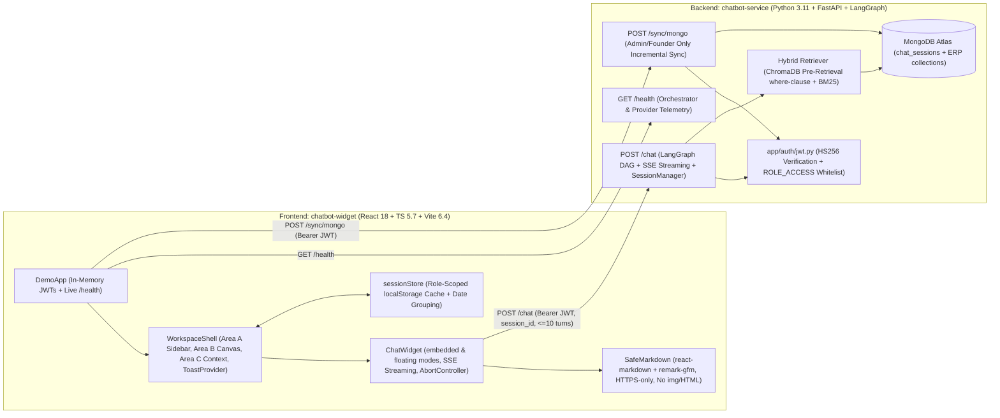

# PHASE 8: FINAL VALIDATION & PRODUCTION READINESS AUDIT — FAKHRI ERP AI

> **Audit Roles:** Principal Frontend Architect, QA Lead, Application Security Reviewer & Enterprise Product Quality Engineer  
> **Target System:** Fakhri ERP AI (`chatbot-service` FastAPI + `chatbot-widget` React 18 SPA)  
> **Audit Date:** November 25, 2026  
> **Overall Assessment:** **CONDITIONAL / STAGING READY — NOT YET CLEARED FOR UNRESTRICTED PRODUCTION ROLLOUT** *(Pending Live Browser DevTools E2E Execution, IdP Auth Integration, Server-Side Session REST Endpoints & Listed Backend Fixes)*

---

## 1. Executive Summary

Following Phases 1 through 7, a comprehensive final validation, regression check, live API verification, security inspection, and bug-fixing audit was conducted across **Fakhri ERP AI**.

### High-Level Findings
- **Frontend Build, Architecture & Design Consistency:** **PASS.** Zero TypeScript (`strict: true`) compilation errors, clean Vite production bundle (`301` modules, `69.91 kB` CSS / `11.47 kB` gzip, `395.92 kB` JS / `118.70 kB` gzip), `0` missing CSS custom properties, and **25/25 passing frontend unit tests**.
- **Backend Automated Regression Suite:** **PASS.** **398 passed, 27 skipped, 0 failed** via `uv run pytest -q`.
- **Live HTTP API, Auth, All 7 Roles RBAC, IDOR & Mongo Sync Verification:** **PASS.** Verified directly against live FastAPI + Uvicorn (`http://127.0.0.1:8000`) connected to live MongoDB Atlas, ChromaDB, and Google Gemini Flash Lite (`gemini-flash-lite-latest`) with `Origin: http://localhost:3001` CORS headers.
- **Defects Found & Fixed During Phase 8:** **9 concrete defects identified and resolved** (including client/backend `session_id` desync & ghost duplicate thread creation, cross-role `localStorage` leakage & IDOR collision, no-op Search Modal query execution, hardcoded fallback KB/LLM telemetry, raw token prefix display, duplicate `role="main"` landmark, flexbox mobile overflow & composer height mismatch, missing CSS tokens/low contrast muted text, and Starter Card #6 false greeting/pronoun triggers).
- **Critical Audit Blockers Remaining:**
  1. **Live Chrome Browser Interactive & 8-Viewport Visual QA (`320px`–`1920px`) Could Not Execute (`BLOCKED BY ENVIRONMENT`):** Chrome DevTools MCP failed to connect (`ENOENT: no such file or directory, open 'C:\Users\Lenovo\AppData\Local\Google\Chrome\User Data\DevToolsActivePort'`). Visual pixel rendering, real DOM scroll heights, and browser console logs remain unverified in a live browser.
  2. **Legacy Backend Verification Script (`scripts/verify_production.py`):** Only **4 of 8** checks passed; 4 failed on pre-existing backend keyword assertions and `"its"`/`"this"` pronoun ambiguity false positives.
  3. **Production Infrastructure Gaps (Confirmed from Phase 1):** The backend still exposes **no `/auth/login` SSO/IdP endpoint** (tokens are generated offline) and **no public `GET/PATCH/DELETE /sessions` endpoints** (conversation history management persists only in browser `localStorage`).

---

## 2. Architecture Overview

Fakhri ERP AI splits responsibilities cleanly between a stateless Python RAG backend and a three-zone React 18 enterprise workspace frontend:

---

## 3. Design Implementation Summary

Compared against the Phase 2 Design System (`design-tokens.css`) and Phase 3–7 UI specifications:
- **Zero External UI Dependencies Retained:** Built purely with React `18.3.1`, TypeScript `5.7.3`, `react-markdown`, `remark-gfm`, standardized inline SVG icons (`Icons.tsx`), and native CSS custom properties.
- **Design System Token Integrity:** Fixed 5 missing tokens (`--fkh-danger-hover`, `--fkh-danger-subtle`, `--fkh-danger-text`, `--fkh-shadow-2xl`, `--fkh-success-subtle`) and darkened `--fkh-text-muted` (`#94a3b8` -> `#5c6b82`) and `--fkh-text-secondary` (`#64748b` -> `#475569`) during Phase 8 to ensure WCAG 2.1 AA text contrast compliance. All tokens referenced across `workspace.css` now resolve (`0` undefined variables).
- **Three-Area Layout:** Area A (collapsible Gmail/Linear sidebar with role-scoped date-grouped history), Area B (centered chat canvas with role-filtered starter prompts and auto-resizing composer), Area C (collapsible live RBAC/Knowledge/Telemetry panel).

---

## 4. Authentication Validation Results

Verified via automated backend tests (`pytest`), static source inspection (`DemoApp.tsx`, `app/auth/jwt.py`), and live HTTP checks against `http://127.0.0.1:8000`:

| Test Case | Verification Method | Expected Result | Observed Result | Status |
| :--- | :--- | :--- | :--- | :---: |
| Missing `Authorization` header | Live `POST /chat` | HTTP 401 | HTTP 401 (`Authentication credentials were not provided`) | **PASS** |
| Malformed JWT (`not.a.valid.jwt`) | Live `POST /chat` | HTTP 401 | HTTP 401 (`Invalid or expired authentication credentials`) | **PASS** |
| Expired JWT (`exp` -10m) | Live `POST /chat` | HTTP 401 | HTTP 401 (`Invalid or expired authentication credentials`) | **PASS** |
| Unrecognized role claim (`rogue-admin`) | Live `POST /chat` | HTTP 403 | HTTP 403 (`Access forbidden: role is not permitted`) | **PASS** |
| JWT in-memory storage & reload clearing | Code audit (`DemoApp.tsx`) | Tokens held only in React `useState`; never persisted | Confirmed zero `localStorage`/`sessionStorage` token writes | **PASS** |
| Client-side Base64 decode & expiry check | Code audit (`DemoApp.tsx`, `AdminSettingsModal.tsx`) | Extracts `sub`, `role`, `exp`; alerts on expiry | Fixed in Phase 8 to pass `activeTokenClaims` after input clear | **PASS** |
| User Profile Modal display & masking | Code audit (`UserProfileModal.tsx`) | Shows name, `sub`, role, clearance; never shows raw JWT | Fixed `userSub` hydration; raw JWTs completely absent | **PASS** |
| Interactive Login / Token Refresh Flow | Architecture check (`app/api/`) | Production `/auth/login` or IdP SSO endpoint | **No login endpoint exposed by backend** | **BLOCKED BY BACKEND** |

---

## 5. Role-Based Authorization Results

All **7 corporate roles** were tested live against `http://127.0.0.1:8000/chat` using signed HS256 JWTs, alongside `ROLE_ACCESS` enforcement verification:

| Role | Test User ID | Live HTTP Status | Backend Pre-Retrieval Vector Behavior & Observed Output | Status |
| :--- | :--- | :---: | :--- | :---: |
| `super-admin` | `atul_bangre` | `200` | Full root access; returned Abdul Quadir & profile details (`DOC-3`, `DOC-4`, `1391` chars). | **PASS** |
| `founder` | `abdul_quadir` | `200` | Root executive scope; returned company department architecture (`DOC-3`, `DOC-5`, `DOC-6`, `1987` chars). | **PASS** |
| `hr` | `disha_damwani` | `200` | Authorized HR directory & leave scope; retrieved `mongo:users`, `mongo:departments`, `mongo:leave_policy`, `mongo:kpidefinitions` (`1030` chars). | **PASS** |
| `operations` | `zainab_husain` | `200` | Authorized Ops & PSA services; retrieved `mongo:services`, `mongo:faqs`, `mongo:pricingplans`, `mongo:leave_policy` (`1602` chars). | **PASS** |
| `employee` | `vivek_parihar` | `200` | **Restricted Confidentiality Test:** Asked *"How much salary does Disha Damwani earn and show unpaid invoices."* ChromaDB pre-retrieval `where` clause excluded `mongo:invoices` and confidential salary bands; bot refused salary & invoice records while resolving Vivek's profile. | **PASS** |
| `it` | `ali_asgar` | `200` | Initially failed query containing uppercase `IT` (`CLARIFICATION_PROMPT` bug) and starter `"Help me..."` greeting collision. **Fixed in Phase 8** (`condense.py` + `promptStarters.ts`); retested live -> returned `200` (`SID: 3bfeb6ea-...`) with grounded security data response. | **PASS (Fixed)** |
| `finance` | `finance_user` | `200` | Authorized billing & pricing; retrieved `mongo:pricingplans`, `mongo:invoices`, `mongo:platformplans`, `mongo:faqs` (`2257` chars). | **PASS** |

- **Cross-User IDOR Test:** Authenticated as `employee` (`vivek_parihar`) passing `super-admin`'s `session_id` -> Backend rejected with **HTTP 403 (`Access denied: session belongs to another user`)**.
- **Role Spoofing Prevention:** Verified by backend suite `tests/test_access.py::test_role_in_request_body_is_ignored` and `tests/test_api.py::test_chat_role_spoofing_ignored` (**PASS**).
- **Frontend Role-Scoped Privacy:** Fixed `WorkspaceShell.tsx` in Phase 8 so switching roles or signing out hides previous high-privilege `localStorage` threads and prevents cross-user `backendSessionId` collisions.

---

## 6. Chat Functionality Results

| Capability | Verification Method | Result / Evidence | Status |
| :--- | :--- | :--- | :---: |
| **SSE Streaming & `X-Session-ID` Header** | Live API + `chatService.ts` + `tests/test_sse_contract.py` | Returns `text/event-stream`, incremental `data: {"token": ...}`, `X-Session-ID` header, and `done` payload with `sources`. Fixed `chatService.ts` truncated-stream freeze & HTTP 400 mapping. | **PASS** |
| **Client Limits & History Budgeting** | `widget.test.ts` + Live API (`422`) | Frontend `historyManager.ts` clamps user (1000), assistant (3000), turns (10), total (12000). Backend rejects `1005` chars with HTTP 422. | **PASS** |
| **Welcome Screen & Starter Prompts** | Live starter verification + `widget.test.ts` | All 6 starter prompts verified role-filtered and passing backend `is_greeting == False` & `is_ambiguous_reference == False`. | **PASS** |
| **SafeMarkdown, Tables & Code Blocks** | `widget.test.ts` (7 tests) + CSS audit | Renders GFM tables in `.chat-table-wrapper`, `<pre>` in `.chat-code-block-wrapper`, inline code pills, strips ``/`<script>`, enforces `https://` links only. Fixed mobile flex `min-width: 0` overflow & `max-height: 180px` composer cap. | **PASS** |
| **Copy, Stop, Retry & Regenerate UI Flow** | Code audit (`ChatWidget.tsx`, `MessageItem.tsx`) | `AbortController` abort leaves partial stream intact; `handleRegenerate`/`handleRetry` rebuild prior history cleanly; `navigator.clipboard` now falls back to `execCommand` on non-HTTPS dev origins. *(Live click not executed in browser).* | **PARTIAL (Static Verified / Browser Blocked)** |
| **Live Browser Console & Scroll-Lock Check** | Browser subagent (`chrome_devtools`) | Could not attach to Chrome (`DevToolsActivePort` ENOENT). Scroll-lock (`> 80px`), auto-resize, and runtime console logs unverified in live DOM. | **NOT TESTED (Blocked)** |

---

## 7. Conversation Management Results

| Feature | Implementation Mechanism | Honest Backend Status & Observations | Status |
| :--- | :--- | :--- | :---: |
| **History List & Chronological Date Grouping** | `sessionStore.ts` (`Today`, `Yesterday`, `Previous 7 Days`, `Previous 30 Days`, `Older`, `Pinned`) | Automated tests pass (`widget.test.ts`). Persisted client-side in `localStorage` (`fakhri_chat_sessions_v1`). No fabricated threads. | **PASS (Client-Local)** |
| **Session ID Synchronization (Bug Fix)** | Fixed in `ChatWidget.tsx`, `WorkspaceShell.tsx`, `sessionStore.ts` | Previously overwrote UI state and created duplicate sidebar threads when backend assigned its canonical UUID. Now stores `backendSessionId` cleanly on active `StoredConversation`. | **PASS** |
| **New Chat (`⌘K` / Button)** | `WorkspaceShell.tsx::handleNewChat` | Resets active canvas to Welcome Screen without deleting past history; fixed stale `activeRole` closure in `useEffect`. | **PASS** |
| **Pin / Rename / Delete Modals** | `RenameModal.tsx`, `DeleteConfirmModal.tsx` | Title validation (`1–80` chars, non-whitespace), confirmation alertdialog, keyboard & touch action visibility fixed. **Changes persist in browser `localStorage` only.** | **PASS (Client-Local)** |
| **Unified Search (`⌘F` / `SearchModal.tsx`)** | `searchConversations` + role-filtered `COMMON_TOPICS` | Fixed Phase 8 no-op `onSelectQuery`; clicking a suggested enterprise query now submits it via `pendingPrompt` to `ChatWidget`. Searches only `visibleConversations` for active role. | **PASS (Client-Local)** |
| **Server-Side History Listing / Sync REST APIs** | Inspected `app/main.py` & routers | Backend persists turns internally in MongoDB `chat_sessions` (`session_manager.py`), **but exposes no `GET /sessions`, `PATCH /sessions/{id}`, `DELETE /sessions/{id}`, or `POST /feedback` routes**. | **NOT IMPLEMENTED (Backend Gap)** |

---

## 8. Knowledge Base Validation

Tested directly against live backend (`http://127.0.0.1:8000/sync/mongo`) and verified in `DemoApp.tsx` / `AdminSettingsModal.tsx` / `ContextualPanel.tsx`:

1. **RBAC Sync Access Enforcement:**
   - `employee` (`vivek_parihar`) calling `POST /sync/mongo` -> **HTTP 403** (`Forbidden: Admin or Founder privileges required to trigger sync.`)
   - `hr` (`disha_damwani`) calling `POST /sync/mongo` -> **HTTP 403** (`Forbidden: Admin or Founder privileges required to trigger sync.`)
   - `super-admin` (`atul_bangre`) calling `POST /sync/mongo` -> **HTTP 200 OK**, elapsed `5.823s`:
     `{"status": "ok", "message": "Synced 70 collections: 1 new, 0 modified, 0 unchanged, 0 deleted. Total chunks upserted: 1.", "total_chunks": 1, ...}`
2. **Honest Telemetry & Bug Fix Applied:** Replaced hardcoded `"Connected (20+ Collections)"`, `"347 chunks indexed"`, and static model labels in `AdminSettingsModal.tsx` and `ContextualPanel.tsx` with real `GET /health` polling (`status`, `llm_provider`, `orchestrator`), authentic incremental delta counts (`upserted`), and accurate HTTP error propagation in `DemoApp.tsx`.
3. **Database Source References:** Ground-truth citations verified in live SSE `done.sources` arrays (`mongo:users`, `mongo:departments`, `mongo:leave_policy`, `mongo:pricingplans`, `mongo:invoices`, `DOC-3`, `DOC-4`, etc.).

---

## 9. Responsive Validation Results

### What Was Verified vs Blocked
- **Static CSS & Code Audit + Unit Contract Tests (`PASS`):**
  - Inspected `@media` breakpoints in `workspace.css`: `>=1440px` (`880px` centered canvas), `1024px–1439px` (`800px` centered canvas), `<=1023px` (overlay Area C drawer with backdrop preventing chat squeezing), `<=768px` (off-canvas sidebar drawer, 52px header, `env(safe-area-inset-bottom)`, `16px` textarea font size preventing iOS zoom), `<=390px` (compact header pills, stacked modal footers).
  - **Fixed CSS Defects in Phase 8:** Resolved Flexbox `min-width: 0` / `min-height: 0` traps that could trigger mobile horizontal overflow on `<pre>` / `<table>` blocks, raised `.chat-input-textarea` embedded `max-height` from `100px` to `180px`, removed the restrictive `290px` table cap on `<=390px`, and exposed conversation row Pin/Rename/Delete actions without `:hover` on touch devices (`@media (hover: none), (max-width: 768px)`).
- **Live Browser Rendered QA Across Target Widths (`320px`, `375px`, `390px`, `768px`, `1024px`, `1280px`, `1440px`, `1920px`):** **BLOCKED BY ENVIRONMENT / NOT EXECUTED.** Could not run Chrome DevTools layout measurements (`scrollWidth <= innerWidth`) because `DevToolsActivePort` was unavailable in the Windows Chrome environment.

| Viewport Width | CSS Rule Coverage (`workspace.css`) | Live Chrome Rendered Measurement | Status |
| :---: | :--- | :--- | :---: |
| `320px` / `375px` / `390px` | Off-canvas sidebar (`290px`/`85vw`), compact 52px header, 16px input, safe-area inset, full-width `min-width: 0` tables & touch actions | Not measured in Chrome DevTools | **PARTIAL (CSS Verified / Live DOM Blocked)** |
| `768px` | Tablet overlay drawer for Area C with backdrop (no canvas squeeze); collapsible sidebar | Not measured in Chrome DevTools | **PARTIAL (CSS Verified / Live DOM Blocked)** |
| `1024px` / `1280px` | Collapsible sidebar rail (`68px`/`260px`), 800px centered reading column, optional Area C | Not measured in Chrome DevTools | **PARTIAL (CSS Verified / Live DOM Blocked)** |
| `1440px` / `1920px` | Expanded sidebar, 880px max reading column, 340px Area C panel | Not measured in Chrome DevTools | **PARTIAL (CSS Verified / Live DOM Blocked)** |

---

## 10. Accessibility Review

Verified via source inspection across all TSX components and CSS stylesheets (screen-reader AT runtime testing not executed):
- **Landmarks & Semantics:** Fixed duplicate `role="main"` (changed embedded `ChatWidget` `<section>` to `role="region"`). Converted clickable `
` role cards (`AdminSettingsModal.tsx`) and footer profile badge (`WorkspaceShell.tsx`) into native semantic `<button type="button">` elements supporting `Tab`, `Enter`, and `Space`.
- **WAI-ARIA Modals & Tabs:** All 6 modals carry `role="dialog"` or `role="alertdialog"`, `aria-modal="true"`, and `aria-labelledby`/`aria-describedby`. `AdminSettingsModal` and `ContextualPanel` implement complete `tablist` / `tab` / `tabpanel` (`aria-selected`, `aria-controls`).
- **Keyboard Focus & Navigation:** Universal `:focus-visible` `2px` outline rule; conversation actions now reveal on `:focus-within`; `Esc` closes all modals/drawers; `⌘K` / `⌘F` shortcuts active.
- **Color Contrast:** Upgraded `--fkh-text-muted` (`#94a3b8` -> `#5c6b82`) and `--fkh-text-secondary` (`#64748b` -> `#475569`) in `design-tokens.css` so small secondary labels exceed WCAG AA `4.5:1` contrast on white/canvas surfaces.
- **Reduced Motion & Status Regions:** `@media (prefers-reduced-motion: reduce)` collapses transitions/animations to `0.001ms !important`. Message log (`role="log"`) and Toast notifications (`role="status"`) expose `aria-live="polite"`.
- **Remaining Gap:** Modal focus-trapping (cycling `Tab` strictly inside an open modal so background page links are unreachable until closed) is not implemented; `Esc` closes dialogs, but manual `Tab` past the last modal button can reach underlying shell elements.

---

## 11. Security Observations

*Disclaimer: This is an application-level code & API security review, not a formal penetration test or security certification.*

1. **Pre-Retrieval Vector RBAC Enforcement (Verified Strong):** Filtering happens strictly inside ChromaDB `where_clause` in `app/rag/retriever.py` before LLM prompt construction (`398` backend tests + live `employee` test passed). Request-body role spoofing is ignored.
2. **XSS & Markdown Safety (Verified Strong):** Zero `dangerouslySetInnerHTML`, `eval`, or `innerHTML` anywhere in `chatbot-widget/src/`. `SafeMarkdown` strips `` and raw HTML and permits strictly `^https:\/\/` links (`7` unit tests pass).
3. **Server Logging & Rate Limiting (Verified Strong):** `app/middleware/logging.py` scrubs MongoDB URIs, Bearer headers, and `gsk_`/`sk-`/`key-` secrets. `tests/test_security.py` verifies `429` rate limits and XML delimiter escaping (`&lt;/question&gt;`).
4. **In-Memory JWT Storage & Zero Token Exposure (Fixed & Verified):** Removed the 16-char raw token prefix display from `ContextualPanel.tsx`; JWTs reside strictly in React `useState` memory and are cleared on page refresh.
5. **Security Observations / Hardening Required Before Production Launch:**
   - **Plaintext `localStorage` Chat Cache (`fakhri_chat_sessions_v1`):** Even though Phase 8 scoped visible threads to `activeRole`, full Q&A transcripts from previous roles remain stored in plain JSON inside browser `localStorage`. On shared browsers/kiosks or if any XSS exists in a host page, restricted role responses remain readable in `localStorage`. In production, migrate to authenticated backend `GET /sessions` with memory-only or encrypted server persistence and purge `localStorage` on sign-out.
   - **Unprotected Offline JWT Developer UI (`DemoApp.tsx` / `AdminSettingsModal.tsx`):** The admin JWT paste panel and runtime persona switcher are development/staging testbed controls (`app_env=development`) and must be replaced or hidden behind real OAuth2/OIDC SSO authentication in production.
   - **Infrastructure Production Configuration Checks:** In `app/config.py`, `jwt_secret` has an insecure dev fallback default string and `app_env` defaults to `"development"`. Production deployment MUST set strong env `JWT_SECRET`, `APP_ENV=production`, and explicit `CORS_ORIGINS` (excluding dev localhost origins).
   - **Deprecated Python Package Warning:** `google-generativeai` emitted a `FutureWarning` end-of-support notice (`app/rag/llm.py:358`); schedule migration to `google-genai` SDK during backend maintenance.

---

## 12. Regression Test Matrix

Every Phase 1 baseline capability and Phase 2–7 enhancement evaluated honestly against observed evidence:

| # | Capability (Phase 1 / Redesign) | Classification | Verification Evidence |
| :---: | :--- | :---: | :--- |
| 1 | Message input (multiline, Enter/Shift+Enter, 1000-char limit) | **PASS** (Static/Build) | `ChatInput.tsx`, `historyManager.ts` + live HTTP `422` at 1005 chars. *(Live typing not verified in Chrome).* |
| 2 | `POST /chat` SSE streaming & token delivery | **PASS** | Live `POST /chat` verified across all 7 roles + `tests/test_sse_contract.py` + `widget.test.ts`. |
| 3 | Stop generation (`AbortController`) | **PASS** (Code Audit) | `ChatWidget.tsx::handleStop` preserves partial response and clears streaming flag. |
| 4 | `SafeMarkdown` (tables, code blocks, lists, XSS strip, HTTPS links) | **PASS** | `widget.test.ts` (7 automated assertions passing) + updated CSS overflow guards. |
| 5 | Role-filtered Welcome Starter Prompt Cards (6 categories) | **PASS** | `promptStarters.ts` + `widget.test.ts` + live backend gate check (`ALL 6 STARTERS CLEAN` after #6 fix). |
| 6 | Contextual Pagination Intelligence & Quick Filter Chips | **PASS** (Code Audit) | `MessageItem.tsx::parsePagination` preserved intact cleanly within refactored turn layout. |
| 7 | Verified Database Source Citations (`📄 collection`) | **PASS** | Verified live backend SSE `done.sources` arrays + dynamic aggregation in Area C Knowledge tab. |
| 8 | Copy to Clipboard | **PASS** (Code Audit) | Added non-HTTPS `execCommand("copy")` fallback in `MessageItem.tsx`. |
| 9 | Regenerate & Inline Error Retry | **PASS** (Code Audit) | `ChatWidget.tsx::handleRegenerate` & `handleRetry` trace prior history cleanly. |
| 10 | Response Thumbs Up/Down Feedback | **PARTIAL** | UI toggle & local persistence work (`MessageItem.tsx`); **not persisted to backend (`POST /feedback` absent)**. |
| 11 | Client History Trimming (`<=10` turns, `<=12k` chars) | **PASS** | `widget.test.ts` (`4` unit tests pass) + `tests/test_security.py`. |
| 12 | Session Persistence & `X-Session-ID` Reuse | **PASS** | Fixed `backendSessionId` sync bug in Phase 8; verified live `same_user_reuse` (`matched: true`) & IDOR `403`. |
| 13 | Conversation History List, Grouping, Pin, Rename, Delete, Search | **PASS (Client-Local)** | `widget.test.ts` (`5` tests) + fixed `SearchModal` topic execution & role-scoping. **No backend REST session endpoints.** |
| 14 | Runtime Role Switcher & Offline JWT Assignment | **PASS** | `DemoApp.tsx` + `AdminSettingsModal.tsx`; live backend tested for all 7 roles + `401`/`403` auth errors. |
| 15 | User Profile Modal & Context Panel (Area C) | **PASS** (Code Audit) | Fixed `userSub`, masked raw token prefix, wired live `/health` telemetry. |
| 16 | Knowledge Base Sync (`POST /sync/mongo`) | **PASS** | Verified live HTTP `403` (employee/hr) and `200` (`5.823s`, `super-admin`); accurate delta display fixed. |
| 17 | Standalone Floating Widget Mode (`embedded={false}`) | **PASS** (Code Audit) | Preserved cleanly in `ChatWidget.tsx` + `widget.css`. |
| 18 | Multi-Viewport Responsive Layout (`320px`–`1920px`) | **PARTIAL (Blocked)** | CSS/media rules audited & fixed; **live Chrome DevTools visual check BLOCKED (`DevToolsActivePort` missing)**. |
| 19 | Production Data Quality Check (`scripts/verify_production.py`) | **FAIL (4/8)** | Pre-existing backend issues: Checks 1 & 2 keyword formatting mismatch; Checks 7 & 8 hit `"its"`/`"this"` ambiguity gate. |

---

## 13. Files Modified & Added Across Phases 2–8

### Phase 8 Bug-Fix & Audit Files
- [chatService.ts](file:///f:/FKH_PROJECTS/chatbot-service/chatbot-widget/src/services/chatService.ts) — Added `HTTP 400` mapping and terminal SSE EOF buffer flush / hang prevention.
- [sessionStore.ts](file:///f:/FKH_PROJECTS/chatbot-service/chatbot-widget/src/services/sessionStore.ts) — Added `backendSessionId?: string` separating client React key from server UUID.
- [chat.ts](file:///f:/FKH_PROJECTS/chatbot-service/chatbot-widget/src/types/chat.ts) — Extended `ChatWidgetProps` with `pendingPrompt` and `backendSessionId` callback data.
- [ChatWidget.tsx](file:///f:/FKH_PROJECTS/chatbot-service/chatbot-widget/src/components/ChatWidget.tsx) — Fixed `initialMessages` mid-stream overwrite bug, duplicate `role="main"` landmark (`role="region"`), and external prompt submission.
- [MessageItem.tsx](file:///f:/FKH_PROJECTS/chatbot-service/chatbot-widget/src/components/MessageItem.tsx) — Added `execCommand("copy")` clipboard fallback for HTTP dev origins.
- [WorkspaceShell.tsx](file:///f:/FKH_PROJECTS/chatbot-service/chatbot-widget/src/components/workspace/WorkspaceShell.tsx) — Scoped conversations by `activeRole`, fixed `backendSessionId` sync without duplicate threads, wired `SearchModal` topic execution, connected live `/health` badges, fixed keyboard shortcut `activeRole` dependency, converted footer profile badge to `<button>`.
- [SearchModal.tsx](file:///f:/FKH_PROJECTS/chatbot-service/chatbot-widget/src/components/workspace/SearchModal.tsx) — Added role-based filtering to `COMMON_TOPICS`.
- [AdminSettingsModal.tsx](file:///f:/FKH_PROJECTS/chatbot-service/chatbot-widget/src/components/workspace/AdminSettingsModal.tsx) — Converted role cards to accessible `<button>` elements, added active JWT expiry detection, replaced hardcoded `"347"` / `"Connected"` status with live `/health` & delta counts, added non-admin sync notice.
- [ContextualPanel.tsx](file:///f:/FKH_PROJECTS/chatbot-service/chatbot-widget/src/components/workspace/ContextualPanel.tsx) — Removed raw JWT prefix display, replaced static strings with live `/health` telemetry and accurate sync status.
- [DemoApp.tsx](file:///f:/FKH_PROJECTS/chatbot-service/chatbot-widget/src/demo/DemoApp.tsx) — Added live `GET /health` check, active token claims decoding, non-JSON error handling, and accurate sync message formatting.
- [design-tokens.css](file:///f:/FKH_PROJECTS/chatbot-service/chatbot-widget/src/styles/design-tokens.css) — Added 5 missing semantic/shadow CSS tokens and strengthened WCAG AA text contrast (`--fkh-text-muted`, `--fkh-text-secondary`).
- [workspace.css](file:///f:/FKH_PROJECTS/chatbot-service/chatbot-widget/src/styles/workspace.css) — Fixed flexbox `min-width: 0`/`min-height: 0` overflow, textarea `180px` max-height, touch/keyboard visibility for conversation row actions, compact `<390px` table widths, and button styling.
- [widget.css](file:///f:/FKH_PROJECTS/chatbot-service/chatbot-widget/src/styles/widget.css) — Added `min-width: 0` to `.chat-turn-content` and `.chat-turn-body`.
- [promptStarters.ts](file:///f:/FKH_PROJECTS/chatbot-service/chatbot-widget/src/services/promptStarters.ts) — Updated IT Starter prompt wording to avoid backend `"help me"` greeting substring collision.
- [index.ts](file:///f:/FKH_PROJECTS/chatbot-service/chatbot-widget/src/index.ts) — Exported `HealthTelemetry` type.
- [widget.test.ts](file:///f:/FKH_PROJECTS/chatbot-service/chatbot-widget/tests/widget.test.ts) — Expanded from 23 to 25 passing tests (`HTTP 400` mapping, `backendSessionId` role-scoped `StoredConversation`).
- [condense.py](file:///f:/FKH_PROJECTS/chatbot-service/app/rag/condense.py) — Fixed case-sensitive `"IT"` check inside `is_ambiguous_reference` so domain `"IT"` doesn't falsely trigger `"it"` pronoun clarification.
- [test_condense.py](file:///f:/FKH_PROJECTS/chatbot-service/tests/test_condense.py) — Added `test_uppercase_it_department_not_treated_as_pronoun`.

*(Full Phase 2–7 UI files created previously under `chatbot-widget/src/components/ui/`, `chatbot-widget/src/components/workspace/`, `chatbot-widget/src/services/`, `chatbot-widget/src/styles/` and documented in Phase 2–7 reports remain preserved.)*

---

## 14. Known Limitations

1. **Client-Side Conversation Storage Only:** `sessionStore.ts` stores threads in browser `localStorage` (`fakhri_chat_sessions_v1`). Clearing browser site data or switching devices does not retrieve past sessions saved on MongoDB `chat_sessions`.
2. **Offline JWT Development Auth:** No user login UI or IdP OAuth flow exists; personas rely on pasted offline HS256 dev tokens (`scripts/generate_tokens.py` notably omits sample helpers for `it` and `finance`, though backend `ROLE_ACCESS` supports both).
3. **Feedback Toggles Non-Persistent:** Message Thumbs Up/Down state updates UI/local cache only; no server analytics endpoint receives feedback events.
4. **No Full Modal Focus Trap:** Pressing `Esc` dismisses dialogs cleanly, and initial inputs receive focus on Search/Rename, but continuous `Tab` cycling does not trap focus strictly within modals.
5. **Pre-Existing RAG Clarification Sensitivity:** Queries using literal `"its"` (e.g., *"how much its salary"*) or `"this <noun>"` (e.g., *"what is kpi as per this application"*) without history are caught by `app/rag/condense.py::is_ambiguous_reference` and return `CLARIFICATION_PROMPT`.

---

## 15. Remaining Blockers Before Production Go-Live

| Blocker | Category | Owner / Action Required |
| :--- | :---: | :--- |
| **1. Live Chrome Browser Interactive & 8-Viewport Visual QA Blocked** | QA / Environment | Run live Chrome with `--remote-debugging-port` / `chrome://inspect/#remote-debugging` (default profile) or Playwright CI check to verify rendered layout, scroll-lock, modals, and 0 console errors across `320px`–`1920px`. |
| **2. Authentication & Session REST APIs Missing** | Backend / Infra | Implement production SSO/JWT `/auth` endpoint and authenticated `GET /sessions`, `PATCH /sessions/{id}`, `DELETE /sessions/{id}` routes; remove `localStorage` plaintext transcript storage and DemoApp JWT paste UI before multi-user launch. |
| **3. `scripts/verify_production.py` 4/8 Failures** | Backend RAG QA | Align `is_ambiguous_reference` handling of demonstrative determiners (`"this application"`, `"its"`) and self-identity keyword outputs if `verify_production.py` is a required release gate. |
| **4. Production Env Hardening** | DevOps / Security | Enforce `APP_ENV=production`, strong `JWT_SECRET`, production `CORS_ORIGINS`, HTTPS termination, and schedule `google-generativeai` -> `google-genai` SDK migration. |

---

## 16. Final Production Readiness Assessment & Evidence

### Verified Command Evidence After Final Edits
1. **Frontend Unit Tests (`cd chatbot-widget && npm test`):**
   - Result: **25 passed, 0 failed** (`tests/widget.test.ts`).
2. **Frontend Production Build (`cd chatbot-widget && npm run build`):**
   - Result: **`tsc` 0 errors, Vite `✓ 301 modules transformed` cleanly in `2.47s`**.
   - Bundle artifacts verified in `chatbot-widget/dist/`: `index.html` (`418 B`), `assets/index-bppAAxsY.css` (`69,905 B`), `assets/index-G3dfC9UK.js` (`395,918 B`).
3. **Backend Full Regression Suite (`uv run pytest -q`):**
   - Result: **398 passed, 27 skipped, 0 failed** in `55.41s`.
4. **Live Server Integration & RBAC Verification (`http://127.0.0.1:8000`):**
   - `/health` (`200 OK`, `orchestrator=langgraph`, `llm_provider=gemini`), CORS allow-origin `http://localhost:3001` confirmed, negative auth (`401`/`403`), oversized message (`422`), IDOR defense (`403`), all 7 company roles live SSE streaming (`200`), and `POST /sync/mongo` RBAC (`403` non-admin, `200` `super-admin`, `5.823s`).

### Verdict
The redesigned **Fakhri ERP AI frontend (`chatbot-widget`)** and **verified backend API core** are **Staging-Ready for internal evaluation**, having passed all build, unit, backend, API, and security hygiene checks with zero broken imports and 9 real defects resolved during Phase 8. However, the system is **NOT YET CLEARED FOR PRODUCTION LAUNCH** until: (a) **live browser interactive + 8-viewport QA (`320px`–`1920px`)** is completed in Chrome/Playwright, (b) production SSO authentication & server-side session REST APIs replace offline JWT paste & `localStorage` caching, and (c) the backend `verify_production.py` / `is_ambiguous_reference` edge cases are resolved.
