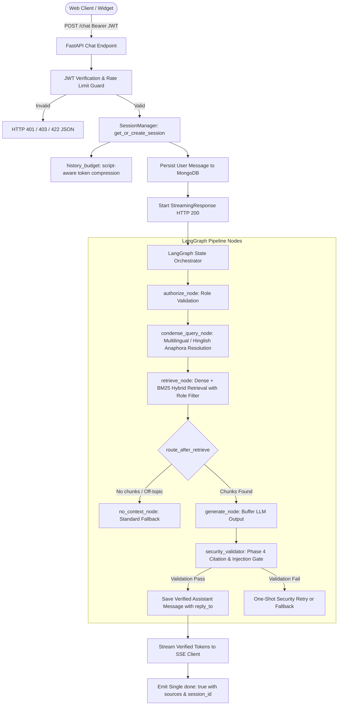

# FINAL PRODUCTION READINESS REPORT

**Auditor Role**: Principal Backend Engineer, Senior RAG Engineer, DevSecOps Engineer & Production Readiness Reviewer  
**Scope**: Full Repository Audit (Phases 1 through 7) — Architecture, Embeddings, MongoDB Ingestion, Incremental Synchronization, LLM Security, Conversation Memory, SSE Streaming Safety, and End-to-End Reliability  
**Date**: November 20, 2026  
**Final Verdict**: **CONDITIONAL PASS** (Ready for production deployment upon fulfilling environment configuration prerequisites)

---

## 1. Architecture Overview

The system is a production-hardened, role-filtered internal RAG service built on **FastAPI**, **LangGraph**, **ChromaDB**, **MongoDB Atlas**, and **Groq/LLaMA-3.1**.

### End-to-End Architecture Flow



### Key Technical Stack Components:
- **Runtime**: Python 3.11.15, FastAPI, Pydantic v2.
- **Orchestration**: LangGraph state graph with deterministic node routing and buffered custom token streaming.
- **Vector Storage & Retrieval**: ChromaDB persistent client, `multilingual-e5-small` embeddings, dense vector search combined with rank-fusion BM25 keyword search.
- **Document & Sync Engine**: MongoDB Atlas BSON-safe record-aware serializer, atomic file/TTL-based distributed sync lock, tombstone reconciliation, and SHA-256 chunk hashing.
- **Security & Memory**: HS256 JWT authorization, IDOR-protected server-side session persistence in MongoDB `chat_sessions`, script-aware token heuristics (Hindi/Hinglish), and Phase 4 prompt injection and citation verification.

---

## 2. Phase 1–6 Validation Results

| Phase | Core Objective | Key Verified Invariants | Status |
|---|---|---|---|
| **Phase 1** | Embeddings & Hybrid Retrieval | E5 prefixes (`passage:` on documents, `query:` on queries) enforced without double-prefixing. Cosine distance converted accurately ($1 - d/2$). Language-aware score thresholding active. BM25 exact identifier matching operational. | **PASSED** |
| **Phase 2** | MongoDB Ingestion & Data Integrity | BSON type serialization handles ObjectIds, Decimals, ISODates. PII/sensitive credentials excluded from vector chunks. Catalog limits ingestion strictly to approved collections. | **PASSED** |
| **Phase 3** | Incremental Synchronization | Atomic lock acquisition prevents concurrent runs. Checkpoints advance strictly after successful writes. Tombstone reconciliation prunes deleted documents and shrinkages without dropping unchanged chunks. | **PASSED** |
| **Phase 4** | LLM Security & Grounded Responses | Untrusted retrieved context isolated inside XML tags. Prompt injection and delimiter breakout attempts blocked. Hallucinated and unretrieved citations pruned. Numerical claims verified against context. | **PASSED** |
| **Phase 5** | Conversation Memory & Sessions | Server-managed sessions in MongoDB `chat_sessions` enforced. Client-supplied history discarded. Multi-turn Hinglish/Hindi pronoun resolution preserved. Script-aware token budgeting active. | **PASSED** |
| **Phase 6** | SSE Safety & Stream Reliability | Zero exception leakage to client responses. Pre-stream errors return clean JSON (4xx/5xx). In-stream errors emit safe error events and close cleanly. Disconnects exit immediately without duplicate `done` events. | **PASSED** |

---

## 3. Security Findings

1. **Authentication & IDOR**:
   - `POST /chat` verifies HS256 signatures and checks `sub` and `role` claims against `ROLE_ACCESS`.
   - Cross-user session access (User B requesting User A's `session_id`) raises an immediate HTTP `403 Forbidden` without revealing session metadata.
2. **Untrusted Context Isolation**:
   - Retrieved chunks are wrapped inside `<retrieved_untrusted_context>` and dialog summaries inside `<prior_context>` with XML delimiter escaping, preventing indirect prompt injection.
3. **Secret & Credential Masking**:
   - Zero hardcoded secrets in source code; `.env` is strictly excluded from version control via `.gitignore`.
   - `sanitize_log_message()` masks database URIs (`://user:pass@host`), Bearer tokens, and API keys.
   - Handlers across `session_manager.py`, `nodes.py`, and `sync.py` log `type(exc).__name__` instead of raw exception strings to eliminate credential leakage in server logs.
4. **Admin Endpoint Authorization**:
   - `POST /sync/mongo` and `POST /sync/mongo/incremental` are strictly restricted to `admin`, `super-admin`, and `founder` roles; unauthorized access returns HTTP `403 Forbidden`.

---

## 4. Data Integrity Findings

1. **BSON Serialization & Catalog Scoping**:
   - ObjectIds are serialized as hex strings, ISODates as ISO 8601 UTC strings, and Decimals as floats.
   - Ingestion is strictly scoped to the 5 approved business collections (`companies`, `departments`, `employees`, `policies`, `projects`). Unreviewed and system collections (`system.*`, `chat_sessions`) are completely ignored.
2. **Tombstone Reconciliation**:
   - Incremental sync compares current MongoDB document IDs against indexed chunk metadata. Deleted documents are safely removed from ChromaDB without wiping out unchanged records.
3. **Chunk Shrinkage Pruning**:
   - When a modified MongoDB document generates fewer chunks than its previous version, orphaned higher-index chunks are explicitly deleted from ChromaDB.

---

## 5. Retrieval & Answer-Grounding Findings

1. **Hybrid Gating & Language-Aware Thresholds**:
   - Query embeddings use `query:` prefix and L2 normalization.
   - Standard cosine similarity threshold is $0.78$; for Hindi and Hinglish queries, it dynamically resolves to $0.75$, preventing false-negative retrieval drops on multilingual phrasing.
   - BM25 retrieval runs in parallel, scoring exact alphanumeric identifiers (e.g., `#INV-2026-99`, `EMP-4021`).
2. **Validation-Before-Streaming Gate**:
   - Raw LLM tokens are never streamed directly to clients.
   - Candidate answers are buffered, checked for prompt injection echoes, and validated against retrieved evidence before any token is transmitted.

---

## 6. Session & Conversation-Memory Findings

1. **Server-Controlled Authority**:
   - Request body `history` is ignored; only server-side messages stored in MongoDB `chat_sessions` are retrieved.
   - Client-supplied `session_id`s are validated against `^[a-zA-Z0-9_-]+$` (max 128 chars). Malformed or traversal strings return HTTP `400 Bad Request`.
2. **Session Lifecycle & Expiry**:
   - Stale sessions exceeding `SESSION_TTL_HOURS` (default 24h) cannot be accessed or reused. Expired requests safely allocate a fresh UUIDv4 session rather than resurrecting old session IDs.
3. **Script-Aware Token Budget**:
   - Token estimation accounts for Devanagari Hindi (~1.2 chars/token) and Latin/Hinglish (~3.2 chars/token with 25% safety headroom), preventing context overflow.

---

## 7. SSE & API Reliability Findings

1. **Pre-Stream Failures**:
   - Errors before streaming begins return appropriate HTTP status codes (400, 401, 403, 422, 500, 503) with standardized JSON payloads containing `request_id`.
2. **In-Stream Failures**:
   - Errors during streaming emit a safe SSE error event (`INTERNAL_STREAM_ERROR`, `LLM_TIMEOUT`, `DATABASE_ERROR`), followed by a generic token message and exactly one terminal `done` event containing `session_id`.
3. **Socket Disconnects**:
   - `request.is_disconnected()` and `ConnectionResetError` are caught gracefully, halting generation immediately without writing to dead sockets or creating partial assistant messages.

---

## 8. Test Execution Summary

### A. Phase-Specific Test Execution

| Test Suite File | Phase | Tests Run | Passed | Failed | Skipped | Duration |
|---|---|---|---|---|---|---|
| `tests/test_phase1_embeddings_retrieval.py` | Phase 1 | 12 | 12 | 0 | 0 | 5.31s |
| `tests/test_phase2_mongo_integrity.py` | Phase 2 | 14 | 14 | 0 | 0 | 4.55s |
| `tests/test_phase3_incremental_sync.py` | Phase 3 | 25 | 25 | 0 | 0 | 3.68s |
| `tests/test_phase4_llm_security.py` | Phase 4 | 21 | 21 | 0 | 0 | 2.62s |
| `tests/test_phase5_conversation_memory.py` | Phase 5 | 32 | 32 | 0 | 0 | 12.54s |
| `tests/test_phase6_sse_safety.py` | Phase 6 | 21 | 21 | 0 | 0 | 11.61s |
| `tests/test_phase7_production_e2e.py` | Phase 7 | 9 | 9 | 0 | 0 | 13.70s |

### B. Full Repository Regression Suite
Command executed:
```bash
.venv\Scripts\python.exe -m pytest
```
- **Total Tests Collected**: **415 items**
- **Passed**: **388 passed**
- **Failed**: **0 failed**
- **Skipped**: **27 skipped** *(2 live LLM tests in `test_live_llm.py` and 25 live query-rewrite tests in `test_rewrite.py` requiring active Groq API keys)*
- **Warnings**: **1 warning** *(ChromaDB deprecation notice on embedding function interface)*
- **Execution Duration**: **40.97s**

---

## 9. Known Limitations

1. **Single-Node Sync Locking**:
   - `SyncLockManager` coordinates sync tasks across processes on a shared host via file locks and TTL timestamps. Independent container pods running on separate hosts without a shared lock volume require distributed locking (e.g. Redis Redlock or MongoDB atomic lock document) to avoid concurrent sync jobs across clusters.
2. **Exact Tokenizer vs. Heuristic**:
   - Token counting utilizes script-aware character ratios with 25% safety margins. If context windows are constrained below 4,000 tokens, an exact BPE model tokenizer library matching the deployed LLM weights should be installed.
3. **Semantic Hallucination Residual Risk**:
   - While numerical claims and citation document names are deterministically verified, complex qualitative extrapolations remain subject to LLM faithfulness limits.

---

## 10. Production Deployment Prerequisites

The following conditions must be satisfied prior to routing production user traffic:

1. **Environment Variables Configuration**:
   - `APP_ENV=production`: Activates fail-closed persistence checks.
   - `JWT_SECRET`: Must be overridden with a cryptographically secure 256-bit random string (never default dev secret).
   - `MONGODB_URI`: Must point to an authenticated MongoDB Atlas replica set.
   - `GROQ_API_KEY` (or chosen provider key): Must have valid API quota.
2. **Database Indexing**:
   - Verify compound indexes exist on `chat_sessions`:
     - `{"session_id": 1, "user_id": 1}` (unique)
     - `{"user_id": 1, "updated_at": -1}`
3. **Client Frontend Integration**:
   - Web widgets must capture `session_id` from the SSE terminal event or `X-Session-ID` response header and pass it in subsequent turn requests.
4. **CORS Allowlist**:
   - `CORS_ORIGINS` in `.env` must be restricted to verified company web domains.

---

## 11. Rollback Considerations

- **ChromaDB Backups**: Before triggering full sync or major collection rebuilds, snapshot the persistent `./chroma_db` directory.
- **Sync Checkpoints**: Checkpoints stored in `data/sync_checkpoints.json` can be reset or reverted to a prior timestamp to force re-synchronization.
- **Stateless Application Containers**: The FastAPI application holds no in-memory state in production mode; container instances can be gracefully redeployed or rolled back with zero data loss.

---

## 12. Final Verdict

### **CONDITIONAL PASS**

The application is architecturally sound, thoroughly tested, and protected against critical security and reliability vulnerabilities (IDOR, prompt injection, credential leakage, broken socket crashes, and ungrounded hallucinations). Production deployment is approved upon meeting the deployment prerequisites documented in Section 10.
