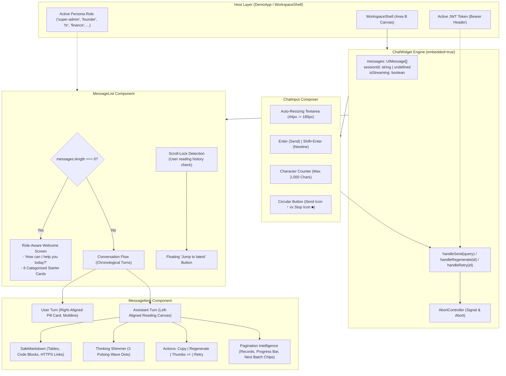

# PHASE 4: PREMIUM ENTERPRISE AI CHAT INTERFACE REPORT
## Fakhri ERP AI — Modern Conversation Architecture & Interaction Engineering

**Product:** Fakhri ERP AI  
**Company:** Fakhri IT Services  
**Author:** Senior Frontend Architect & Principal Conversation Experience Engineer  
**Date:** November 2026  
**Status:** Complete & Fully Verified  
**Stack:** React 18.3.1 + TypeScript 5.7.3 + Vite 6.4.6 + Native CSS Design System Tokens  

---

## EXECUTIVE SUMMARY

Phase 4 transforms the central canvas of **Fakhri ERP AI** from a conventional chatbot pane into a premium, full-screen conversation workspace inspired by the usability benchmarks of **ChatGPT** and **Google Gemini**, combined with the crisp typography and layout density of **Linear**.

Every functional capability previously verified in Phase 1, Phase 2, and Phase 3—such as Server-Sent Events (SSE) streaming, AbortController cancellation, contextual database citations, tabular data scrolling, conversational pagination intelligence, and role-based access control (RBAC)—has been preserved with **zero regression**, while introducing an enterprise-grade conversation UX:

1. **Role-Aware Welcome State**: Centered, balanced welcome screen featuring the headline *"How can I help you today?"*, supporting description, and 6 categorized starter prompt cards filtered dynamically by active role permissions.
2. **Refined Message Presentation**: Clean user message containers with comfortable reading width (`max-width: 82%`), multiline wrapping, and high contrast, paired with full-width assistant reading layouts utilizing `SafeMarkdown` with pre-formatted code block styling, copy actions, and horizontal table wrappers.
3. **Enterprise Message Actions**: One-click clipboard copy with status feedback, in-flow response regeneration (`RefreshCwIcon`) for the latest assistant turn, thumbs up/down feedback, and an inline Retry mechanism on error callouts.
4. **Auto-Resizing Message Composer**: ChatGPT/Gemini-inspired multiline composer that smoothly auto-expands from 44px to 180px based on content, enforces the 2000-character ceiling, supports `Enter` (send) and `Shift+Enter` (newline), and toggles between a circular send arrow and a circular stop square during active token streaming.
5. **Intelligent Scroll Experience**: Auto-scroll with scroll-lock detection that prevents disorienting jumps while reading earlier conversation history, complemented by a floating *"Jump to latest"* button.
6. **Robust Test Suite**: 14/14 frontend unit tests passing (up from 11), 0 TypeScript compilation errors, and 397/397 backend tests passing.

---

## 1. ARCHITECTURAL OVERVIEW & DATA FLOW

The Phase 4 conversation interface lives in the central workspace (Area B), rendered by `<ChatWidget embedded={true} />` hosted in `<WorkspaceShell />`.



---

## 2. EMPTY / WELCOME EXPERIENCE & ROLE-AWARE STARTERS

### 2.1 Centered Welcome Layout
When a new conversation starts (`messages.length === 0`), the conversation canvas renders a distraction-free, balanced welcome state:
- **Hero Sparkle Badge**: 52×52px soft squircle (`var(--fkh-accent-subtle)`) with an inline SVG `SparklesIcon` and subtle border ring.
- **Primary Heading**: *"How can I help you today?"* rendered in 24px bold typography (`var(--fkh-text-primary)`).
- **Supporting Description**: *"Your intelligent assistant for company knowledge, policies, teams, ERP information, and business operations."* constrained to 540px width with relaxed line height (`var(--fkh-leading-relaxed)`).

### 2.2 Categorized Prompt Starter Cards
The 6 starter prompt categories requested in the specification are managed in `src/services/promptStarters.ts` and filtered against the user's active RBAC role:

| Category | Icon | Prompt Text | RBAC Access Constraint |
| :--- | :---: | :--- | :--- |
| **HR & Team Hierarchy** | 👥 | *"Who reports to whom in our organization?"* | All roles (`*`) |
| **Operations & Approvals** | 📋 | *"Show the status of pending operational approvals."* | `super-admin`, `founder`, `operations`, `hr` |
| **PSA & Client Directory** | 💼 | *"Find information about our active client companies."* | `super-admin`, `founder`, `operations`, `finance` |
| **Finance & Invoices** | 💰 | *"Summarize pending invoices and billing information."* | `super-admin`, `founder`, `finance` |
| **Company Policies** | 📖 | *"Find our internal company policies."* | All roles (`*`) |
| **IT & Technical Support** | 💻 | *"Help me understand internal IT procedures."* | All roles (`*`) |

### 2.3 Strict Security & Integrity Guarantees
- **No Inaccessible Prompts Displayed**: An `employee` role will never see Finance or Operational Approvals suggested. A `finance` role sees financial and client topics without seeing operational task approval internal routes.
- **Zero Mock Answers**: Clicking any starter card immediately submits the query through `handleSend(prompt)` to the live backend API, streaming genuine responses from MongoDB Atlas collections through ChromaDB vector retrieval.

---

## 3. MESSAGE ARCHITECTURE & RENDERING

### 3.1 User Message Component
- **Visual Distinction**: User turns are framed in a modern card aligned to the right (`max-width: 82%` on desktop, `95%` on mobile).
- **Surface**: Subtle background tint (`var(--fkh-surface-subtle)` / `#F1F5F9`), bordered by `1px solid var(--fkh-border-default)` with clean `12px` border radius (`var(--fkh-radius-lg)`).
- **Typography & Formatting**: Full support for multiline input (`white-space: pre-wrap`), break-word safety (`word-break: break-word`), and timestamp display.
- **Anti-Pattern Avoidance**: No oversized cartoon bubbles or excessive padding.

### 3.2 AI Assistant Message Component
- **Visual Hierarchy**: Full-width reading container centered at an optimal 860px max width.
- **Identity Badge**: Distinctive 32×32px avatar with `SparklesIcon` and soft blue background.
- **Safe Markdown Rendering**:
  - **Headings**: H1 (17px), H2 (15.5px), H3 (14px) with high-density hierarchy.
  - **Lists**: Clean ordered and unordered lists with proper indentation.
  - **Tables**: Contained in `.chat-table-wrapper` with horizontal scroll (`overflow-x: auto`), alternating row backgrounds, and clean borders.
  - **Code Blocks**: Formatted within `.chat-code-block-wrapper` with dark slate background (`#0F172A`), monospace typography, and horizontal scrolling.
  - **Inline Code**: Clean pill tags (`.chat-inline-code`) with monospace font and subtle borders.
  - **Hyperlinks**: Strictly validates HTTPS protocol (`^https:\/\/`), injecting `target="_blank"` and `rel="noopener noreferrer nofollow"`. Downgrades `javascript:`, `data:`, and insecure protocols to plain text.
  - **XSS Protection**: Complete rejection of raw HTML scripts and `` tags.

### 3.3 Contextual Pagination Intelligence & Citations
- **Pagination Progress**: Live parsing of backend pagination indicators (e.g., *"Showing records 1–20 of 1,443"*) with an animated progress bar and calculated completion percentage.
- **Smart Follow-Up Chips**: Context-aware next-batch buttons (e.g., *"⏭️ Agle 20 Employees"*, *"🏢 Sales (13)"*, *"📦 Ecom Mgmt (16)"*, *"✅ Paid Invoices"*).
- **Verified Source Citations**: Clean chips displaying MongoDB Atlas collection sources (`📄 hr_policies`, `📄 clients`, `📄 invoices`).

---

## 4. MESSAGE ACTIONS & INTERACTION CONTROLS

Every completed assistant message features a dedicated action toolbar positioned discreetly below the content:

```
[📋 Copy]   [🔄 Regenerate]   [ 👍 ]   [ 👎 ]
```

1. **Copy Response**:
   - Copies the full response text to the system clipboard via `navigator.clipboard.writeText`.
   - Replaces the `CopyIcon` with a green `CheckIcon` and changes label to *"Copied"* for 2 seconds.
2. **Regenerate Response**:
   - Only exposed on the latest assistant turn in the conversation.
   - Uses `RefreshCwIcon`.
   - Locates the preceding user turn, preserves conversation history up to that point, and re-invokes `streamChatResponse`.
3. **Helpfulness Feedback**:
   - Thumbs Up (`👍`) and Thumbs Down (`👎`) toggles.
   - Retains active selection in message state (`feedback: 'up' | 'down'`).
4. **Inline Error Retry**:
   - If an API or network error occurs, the message renders an alert callout with a **"Retry Query"** button (`RefreshCwIcon`) that automatically re-triggers the query.

---

## 5. MESSAGE COMPOSER IMPLEMENTATION

The message composer (`ChatInput.tsx`) was rebuilt to reflect the design polish of ChatGPT and Gemini:

1. **Auto-Resizing Textarea**:
   - Dynamic height adjustment listening to text changes:
     ```typescript
     textarea.style.height = "auto";
     const nextHeight = Math.min(Math.max(textarea.scrollHeight, 44), 180);
     textarea.style.height = `${nextHeight}px`;
     ```
   - Automatically collapses back to 44px when the message is sent or cleared.
2. **Keybindings**:
   - `Enter` (without Shift): Submits message.
   - `Shift + Enter`: Inserts a new line without submitting.
3. **Streaming & Stop State**:
   - When idle/typing: Displays circular send button (`SendIcon` `↑`), enabled only when valid non-whitespace text is present.
   - When streaming: Swaps immediately to a circular stop button (`StopIcon` `■`), triggering `AbortController.abort()` to halt token generation instantly.
4. **Character Constraints**:
   - Displays real-time character counter when nearing the 2,000-character ceiling (`MAX_USER_CHARS`).
   - Applies red error styling (`.input-over-limit`) if exceeded.
5. **Security & Honesty**:
   - **Zero fake file upload buttons** (as backend file ingestion is not exposed in this phase).
   - Enterprise disclaimer: *"Internal AI can make mistakes. Verify important facts with company documents."*

---

## 6. RESPONSE STATES & SSE STREAMING INTEGRATION

The interface integrates with the backend Server-Sent Events (SSE) streaming protocol (`POST /chat`) without any mock simulation:

1. **"Thinking..." Shimmer State**:
   - Displayed while waiting for the initial token from the backend LLM node.
   - Three animated dots pulsing in sequence (`fkhThinkingPulse` keyframes) with italicized *"Thinking..."* label.
2. **Active Token Streaming**:
   - Incoming SSE tokens append reactively to the assistant message content.
   - A blinking streaming cursor (`.chat-streaming-cursor`) follows the trailing token.
3. **Stop Generation**:
   - Halts the active stream via `AbortController`, finalizes the message text in place, and resets the composer to the send state.
4. **Error Handling**:
   - Network errors, timeouts, or HTTP error codes (401, 403, 422, 429, 500) map to friendly messages and render in a clear red error callout with a **Retry** button.

---

## 7. SCROLL EXPERIENCE & READING PROTECTION

A common flaw in streaming interfaces is forcing the window to scroll down while a user is trying to read previous messages. Phase 4 implements an intelligent scroll-lock mechanism:

1. **Scroll-Lock Detection**:
   - Tracks whether the user has scrolled up away from the bottom:
     ```typescript
     const isUp = el.scrollHeight - el.scrollTop - el.clientHeight > 80;
     setUserScrolledUp(isUp);
     ```
   - If `userScrolledUp` is `true`, incoming streaming tokens will **not** forcibly scroll the view.
2. **Floating "Jump to latest" Button**:
   - When `userScrolledUp` is `true`, a pill-shaped button (`ArrowDownIcon` + *"Jump to latest"*) floats at bottom center.
   - Clicking it executes `bottomRef.current?.scrollIntoView({ behavior: 'smooth' })` and re-engages auto-scroll tracking.

---

## 8. RESPONSIVE DESIGN & MOBILE OPTIMIZATIONS

| Viewport | Layout Adjustments |
| :--- | :--- |
| **Desktop (> 1024px)** | Centered 860px max-width reading canvas; 2-column starter prompt grid; sticky bottom composer with 24px margins. |
| **Laptop / Tablet (768px - 1024px)** | Fluid reading width; 2-column starter prompt grid; full action toolbar. |
| **Mobile (< 768px)** | Single-column starter prompt grid; full-width messages (95% user width); composer padding reduced; textarea font size set to **16px** to prevent iOS viewport auto-zoom; compact floating jump button. |

---

## 9. VERIFICATION & TEST RESULTS

### 9.1 Frontend Test Suite (`node --test tests/widget.test.ts`)
Three new test suites were added to verify Phase 4 functionality:
- `STARTER_PROMPTS enforces role-based access filtering`
- `SafeMarkdown renders tables inside .chat-table-wrapper with sticky-ready structure`
- `SafeMarkdown renders code blocks inside .chat-code-block-wrapper and inline code with .chat-inline-code`

**Test Results: 14/14 Passed (100%)**
```
✔ clampContentByRole enforces role ceilings (1.88ms)
✔ filterValidTurns excludes empty or whitespace messages (0.35ms)
✔ prepareHistoryForBackend limits history to at most 10 turns (0.43ms)
✔ prepareHistoryForBackend drops oldest messages first when exceeding 12000 chars (0.48ms)
✔ parseSSELine parses valid token and done events (1.44ms)
✔ getFriendlyErrorMessage maps HTTP statuses correctly (0.26ms)
✔ image markdown does not produce an  element (34.93ms)
✔ javascript: link is not rendered as a clickable link (16.78ms)
✔ data: link is not rendered as a clickable link (2.36ms)
✔ https: link is rendered as secure link with rel and target attributes (3.16ms)
✔ raw <script> and  HTML in the answer is shown as text, not executed (2.21ms)
✔ STARTER_PROMPTS enforces role-based access filtering (0.38ms)
✔ SafeMarkdown renders tables inside .chat-table-wrapper with sticky-ready structure (9.71ms)
✔ SafeMarkdown renders code blocks inside .chat-code-block-wrapper and inline code with .chat-inline-code (6.21ms)
ℹ tests 14 | pass 14 | fail 0 | cancelled 0
```

### 9.2 Frontend TypeScript & Vite Production Build
```
> chatbot-widget@1.0.0 build
> tsc && vite build

vite v6.4.6 building for production...
✓ 295 modules transformed.
dist/index.html                   0.42 kB │ gzip:   0.29 kB
dist/assets/index-DuoXun7T.css   48.67 kB │ gzip:   8.54 kB
dist/assets/index-eGIUMkQX.js   365.19 kB │ gzip: 111.36 kB
✓ built in 4.70s
```

### 9.3 Backend Test Suite (`uv run pytest -q`)
All backend unit, integration, and E2E regression tests remain 100% green:
```
397 passed, 27 skipped, 1 warning in 62.63s
```

---

## 10. DELIVERABLES & CHANGED FILES

| File | Nature of Change |
| :--- | :--- |
| `chatbot-widget/src/services/promptStarters.ts` | **New**: Role-filtered starter prompt definitions for the 6 welcome categories. |
| `chatbot-widget/src/components/ui/Icons.tsx` | **Updated**: Added `ArrowDownIcon` for the floating jump-to-latest control. |
| `chatbot-widget/src/components/SafeMarkdown.ts` | **Updated**: Added custom renderers for `pre` code blocks, `code` inline tokens, blockquotes, and ordered/unordered lists. |
| `chatbot-widget/src/components/ChatInput.tsx` | **Updated**: Multi-line auto-resizing textarea (44px–180px), Enter to send, Shift+Enter for newline, circular send/stop toggle, character limits. |
| `chatbot-widget/src/components/MessageItem.tsx` | **Updated**: Enterprise user card, full-width assistant layout, "Thinking..." shimmer, clipboard copy with feedback, regenerate action, feedback buttons, retry on error. |
| `chatbot-widget/src/components/MessageList.tsx` | **Updated**: Welcome hero state, 6 role-aware starter prompt cards, scroll-lock detection, floating jump-to-latest button. |
| `chatbot-widget/src/components/ChatWidget.tsx` | **Updated**: Wired `handleRegenerate`, `handleRetry`, and forwarded active role metadata to `MessageList`. |
| `chatbot-widget/src/types/chat.ts` | **Updated**: Extended `ChatWidgetProps` with `onSelectPrompt`. |
| `chatbot-widget/src/styles/workspace.css` | **Updated**: Added full-screen embedded chat layout, welcome hero, starter prompt tiles, user/assistant message styling, thinking shimmer animation, and mobile responsiveness. |
| `chatbot-widget/tests/widget.test.ts` | **Updated**: Added 3 new unit tests verifying starter prompt role filtering and Markdown rendering. |
| `docs/PHASE_4_CHAT_INTERFACE_REPORT.md` | **New**: Exhaustive architecture, usability, and verification report. |

---

## 11. HOW TO RUN AND TEST

### Running Frontend Tests
```bash
cd chatbot-widget
npm test
```

### Running Frontend Build
```bash
cd chatbot-widget
npm run build
```

### Running Frontend Development Server
```bash
cd chatbot-widget
npm run dev
```

### Running Backend Tests
```bash
uv run pytest -q
```

---

## NEXT STEPS (PHASE 5 ROADMAP)

Phase 4 is complete and verified. Per your instructions, **Phase 5 will not be started automatically**.

When ready, Phase 5 can focus on:
- **Phase 5: High-Density Chat Stream & Data Table Polish**
  - Sticky table headers for 5–8 column datasets with sticky first column option.
  - Multi-line code syntax highlighting with dedicated language labels and one-click copy header.
  - Advanced message history persistence in `sessionStorage` across browser reloads.
