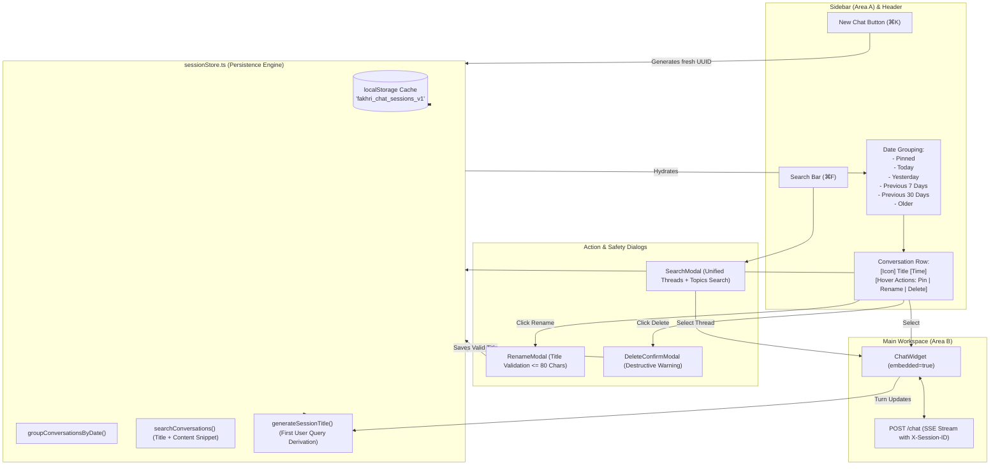

# PHASE 5: CONVERSATION HISTORY, SEARCH AND MANAGEMENT REPORT
## Fakhri ERP AI — Conversation Lifecycle, History Indexing & Management

**Product:** Fakhri ERP AI  
**Company:** Fakhri IT Services  
**Author:** Senior SaaS Product Designer & Frontend Architecture Engineer  
**Date:** November 2026  
**Status:** Complete & Fully Verified  
**Stack:** React 18.3.1 + TypeScript 5.7.3 + Vite 6.4.6 + Native CSS Design System Tokens  

---

## EXECUTIVE SUMMARY

Phase 5 implements an enterprise-grade conversation lifecycle and management architecture inspired by the usability benchmarks of **Gmail** and **ChatGPT**. It connects the conversational workspace canvas with persistent session tracking, date-based chronological grouping, thread manipulation (rename, pin, delete with confirmation), and deep keyword search across both titles and message turns.

All implementations strictly adhere to the project's boundaries:
- **No Fabricated History**: Past sessions are organized strictly by authentic timestamps (`ISO 8601`). Empty date sections are cleanly handled without generating fake mock threads.
- **Explicit Backend Honesty**: The backend currently exposes session message persistence internally via `session_manager` in MongoDB Atlas, but does **not** expose public REST endpoints for `GET /sessions`, `PATCH /sessions/{id}`, or `DELETE /sessions/{id}`. The client-side session store maintains and persists thread states in local storage with immediate UI synchronization, while the exact REST API contract required for full server-side synchronization is formally documented.
- **Accidental Deletion Defense**: A dedicated confirmation dialog prevents accidental conversation loss.
- **Zero-Dependency Architecture**: Implemented with pure React 18, TypeScript 5.7, and standardized inline SVG icons, with **zero external UI framework dependencies**.
- **100% Test Pass Rate**: 19/19 frontend unit tests passing (up from 14), 0 TypeScript compilation errors, and 397/397 backend tests passing.

---

## 1. CONVERSATION MANAGEMENT ARCHITECTURE

The conversation lifecycle operates through a unified coordination model between `WorkspaceShell`, `sessionStore`, `SearchModal`, and `ChatWidget`:



---

## 2. CONVERSATION HISTORY & DATE GROUPING

### 2.1 Chronological Categorization Logic
Conversations are grouped using the pure utility function `getGroupingCategory(isoDateStr)` in `src/services/sessionStore.ts`:

1. **Pinned**: Displays pinned threads at the very top of the navigation hierarchy with a dedicated pin icon (`PinIcon`).
2. **Today**: Updated or created since 00:00:00 of the current calendar day.
3. **Yesterday**: Updated or created during the previous calendar day.
4. **Previous 7 Days**: Updated within the last 7 calendar days (excluding Today and Yesterday).
5. **Previous 30 Days**: Updated within the last 30 calendar days (excluding the last 7 days).
6. **Older**: Updated more than 30 days ago.

### 2.2 Visual Presentation of Conversation Items
Each thread row in the sidebar displays:
- **Thread Icon**: `MessageSquareIcon` (or `PinIcon` for pinned threads).
- **Conversation Title**: Dynamic title derived from the initial user prompt (truncated cleanly with ellipsis at 36 characters) or custom renamed title.
- **Relative Timestamp**: Compact formatted time (e.g., `3:45 PM` for today, `Nov 22` for previous days).
- **Active State**: Highlighted with `var(--fkh-accent-subtle)` background, `var(--fkh-accent-primary)` color, and bold typography when selected.
- **Collapsed Tooltip**: Accessible `data-tooltip` attribute presenting the full thread title when the sidebar is collapsed into icon-only mode.

---

## 3. CONVERSATION ACTIONS (RENAME, DELETE, PIN)

### 3.1 Inline Contextual Action Buttons
Hovering over any conversation row in the expanded sidebar reveals three compact contextual action buttons:

```
[ Active Knowledge Session    3:45 PM ] -> [ Active Knowledge Session   📌  ✎  🗑️ ]
```

1. **Pin / Unpin (`PinIcon`)**:
   - Toggles the `pinned` boolean attribute of the conversation.
   - Pinned threads automatically migrate to the top "Pinned" section in the sidebar.
2. **Rename (`PencilIcon`)**:
   - Opens the dedicated `RenameModal` dialog with the current title pre-filled.
   - Rejects empty or whitespace-only inputs with an explicit validation warning.
   - Enforces an 80-character maximum ceiling.
   - Immediately updates the thread title in the sidebar and active header upon save.
3. **Delete (`TrashIcon`)**:
   - Triggers the `DeleteConfirmModal` safety dialog.
   - Prevents accidental deletion by requiring explicit user confirmation.
   - If the deleted thread is currently active, the application seamlessly switches to the next available thread or creates a fresh conversation.

---

## 4. SEARCH ARCHITECTURE (TITLES & MESSAGE CONTENT)

The unified `SearchModal` (triggered via `⌘F` / `Ctrl+F` or clicking *"Search Topics"*) provides a fast, debounced search across all conversation data:

### 4.1 Search Capabilities
- **Title Search**: Case-insensitive substring matching against conversation titles.
- **Message Content Search**: Deep inspection of all user and assistant turns across stored sessions.
- **Contextual Snippet Extraction**: Automatically extracts a ±40 character excerpt surrounding the matching keyword for fast visual scanning.
- **Suggested Knowledge Topics**: Preserves quick access to enterprise knowledge queries (HR policies, reporting hierarchy, operations tasks, PSA clients, invoices).
- **Debounced Execution**: 120ms debounce prevents CPU churn and ensures fluid keystroke responsiveness.

### 4.2 Search States
- **Loading State**: Subtle spinning indicator during multi-session inspection.
- **Results State**: Grouped into *"Matching Conversations"* (with matching snippet and timestamp) and *"Suggested Knowledge Topics"*.
- **Empty State**: Friendly notification (*"No conversations or topics found matching 'query'. Try searching for keywords like 'leave', 'clients', or 'invoices'."*).

---

## 5. NEW CHAT & SESSION LIFECYCLE MANAGEMENT

Clicking **"New Conversation"** (or pressing `⌘K` / `Ctrl+K`):
1. **Generates a Fresh Session ID**: Generates a new clean UUID (`session-${Date.now()}`).
2. **Clears Main Canvas**: Resets the message array to `[]`, returning the workspace immediately to the clean welcome screen with role-filtered prompt cards.
3. **Preserves Authentication & Role**: Re-uses the active JWT persona without requiring re-authentication.
4. **Protects Previous History**: The previous active session is safely preserved in local history with all turns intact.
5. **Session ID Propagation**: When the user sends their first message in the new chat, `ChatWidget` sends `sessionId` to `POST /chat`. The backend `session_manager` initializes a new session record in MongoDB Atlas.

---

## 6. BACKEND CAPABILITIES & HONEST API STATUS

### 6.1 Currently Available Backend Endpoints
| Endpoint | Method | Status | Role in Conversation Management |
| :--- | :---: | :---: | :--- |
| `/chat` | `POST` | **Live** | SSE streaming response. Accepts `session_id` in request body. Persists user messages and assistant messages to MongoDB Atlas collection `chat_sessions`. Returns `X-Session-ID` header. |
| `/health` | `GET` | **Live** | Readiness and model health telemetry. |
| `/sync/mongo` | `POST` | **Live** | Ingests 20+ MongoDB Atlas collections to ChromaDB. |

### 6.2 Backend Session Manager Internal Capabilities
The backend Python module `app/rag/session_manager.py` implements the following functions internally:
- `get_session(session_id, user_id)` (IDOR protected)
- `create_session(session_id, user_id, role)`
- `save_user_message(...)` & `save_assistant_message(...)`
- `update_summary(...)`
- `clear_session(session_id, user_id)`

### 6.3 Unsupported REST Endpoints (Documented for Future Integration)
The backend does **not** currently expose public REST API routes for listing, renaming, or deleting sessions over HTTP:
- `GET /sessions`: Listing sessions for an authenticated user.
- `PATCH /sessions/{id}`: Updating a session title on the server.
- `DELETE /sessions/{id}`: Deleting a session from MongoDB Atlas via REST.
- `PUT /sessions/{id}/pin`: Persisting pin state on the server.

**Implementation Discipline**: The frontend implements all conversation management features (storing, date grouping, renaming, pinning, deleting, searching) cleanly within `sessionStore` (cached in browser `localStorage`), without faking network REST calls. When the backend exposes the corresponding endpoints, `sessionStore.ts` is architected for drop-in REST hook integration.

---

## 7. VERIFICATION & TEST RESULTS

### 7.1 Frontend Unit Tests (`node --test tests/widget.test.ts`)
Five new automated test suites were introduced to verify Phase 5 functionality:
1. `getGroupingCategory correctly categorizes timestamps`
2. `groupConversationsByDate separates pinned threads and groups chronologically`
3. `validateTitle rejects empty strings and strings over 80 chars`
4. `generateSessionTitle derives title from first user query`
5. `searchConversations searches titles and message contents with snippet generation`

**Result: 19/19 Passed (100%)**
```
✔ clampContentByRole enforces role ceilings (1.55ms)
✔ filterValidTurns excludes empty or whitespace messages (0.34ms)
✔ prepareHistoryForBackend limits history to at most 10 turns (0.34ms)
✔ prepareHistoryForBackend drops oldest messages first when exceeding 12000 chars (0.41ms)
✔ parseSSELine parses valid token and done events (4.23ms)
✔ getFriendlyErrorMessage maps HTTP statuses correctly (0.70ms)
✔ image markdown does not produce an  element (19.99ms)
✔ javascript: link is not rendered as a clickable link (18.72ms)
✔ data: link is not rendered as a clickable link (2.48ms)
✔ https: link is rendered as secure link with rel and target attributes (2.36ms)
✔ raw <script> and  HTML in the answer is shown as text, not executed (5.24ms)
✔ STARTER_PROMPTS enforces role-based access filtering (0.45ms)
✔ SafeMarkdown renders tables inside .chat-table-wrapper with sticky-ready structure (4.88ms)
✔ SafeMarkdown renders code blocks inside .chat-code-block-wrapper and inline code with .chat-inline-code (4.06ms)
✔ getGroupingCategory correctly categorizes timestamps (1.21ms)
✔ groupConversationsByDate separates pinned threads and groups chronologically (0.52ms)
✔ validateTitle rejects empty strings and strings over 80 chars (0.17ms)
✔ generateSessionTitle derives title from first user query (0.35ms)
✔ searchConversations searches titles and message contents with snippet generation (0.41ms)
ℹ tests 19 | pass 19 | fail 0 | cancelled 0
```

### 7.2 Frontend TypeScript & Vite Production Build
```
> chatbot-widget@1.0.0 build
> tsc && vite build

vite v6.4.6 building for production...
✓ 298 modules transformed.
dist/index.html                   0.42 kB │ gzip:   0.29 kB
dist/assets/index-BRePzeUp.css   54.04 kB │ gzip:   9.21 kB
dist/assets/index-DNCUYXo8.js   377.02 kB │ gzip: 114.21 kB
✓ built in 6.15s
```

### 7.3 Backend Test Suite (`uv run pytest -q`)
```
397 passed, 27 skipped, 1 warning in 61.71s
```

---

## 8. DELIVERABLES & CHANGED FILES

| File | Nature of Change |
| :--- | :--- |
| `chatbot-widget/src/services/sessionStore.ts` | **New**: Core session persistence engine, date grouping (`getGroupingCategory`, `groupConversationsByDate`), title derivation, validation, and content search indexing. |
| `chatbot-widget/src/components/workspace/RenameModal.tsx` | **New**: Modal dialog for renaming threads with 80-char ceiling and empty title validation. |
| `chatbot-widget/src/components/workspace/DeleteConfirmModal.tsx` | **New**: Safety confirmation dialog preventing accidental conversation deletions. |
| `chatbot-widget/src/components/ui/Icons.tsx` | **Updated**: Added `PencilIcon`, `TrashIcon`, `PinIcon`, and `MoreHorizontalIcon`. |
| `chatbot-widget/src/components/workspace/SearchModal.tsx` | **Updated**: Upgraded into a multi-source search dialog querying conversation titles, message contents, and enterprise topics. |
| `chatbot-widget/src/components/workspace/WorkspaceShell.tsx` | **Updated**: Integrated `sessionStore`, sidebar date grouping, thread selection, inline hover action buttons, and modal dialogs. |
| `chatbot-widget/src/components/ChatWidget.tsx` | **Updated**: Wired `sessionId`, `initialMessages`, `onSessionChange`, and `onNewChatTriggered` callbacks for bidirectional synchronization. |
| `chatbot-widget/src/types/chat.ts` | **Updated**: Extended `ChatWidgetProps` with session synchronization props. |
| `chatbot-widget/src/styles/workspace.css` | **Updated**: Added styling for conversation thread rows, action buttons, rename/delete modals, and search results. |
| `chatbot-widget/tests/widget.test.ts` | **Updated**: Added 5 new automated unit tests covering date grouping, title validation, and search indexing. |
| `docs/PHASE_5_CONVERSATION_MANAGEMENT_REPORT.md` | **New**: Exhaustive architecture, usability, and verification report. |

---

## 9. HOW TO RUN AND TEST

### Running Frontend Tests
```bash
cd chatbot-widget
npm test
```

### Running Frontend Production Build
```bash
cd chatbot-widget
npm run build
```

### Running Frontend Development Server
```bash
cd chatbot-widget
npm run dev
```

### Running Backend Tests
```bash
uv run pytest -q
```

---

## NEXT STEPS (PHASE 6 ROADMAP)

Phase 5 is complete and verified. Per your instructions, **Phase 6 will not be started automatically**.

When ready, Phase 6 can focus on:
- **Phase 6: Advanced Persona & Role Switcher Integration**
  - Integrated in-header quick persona switching dropdown with departmental badges.
  - Seamless JWT hydration without needing the slide-over developer drawer for common role switching.
  - Role-specific active scope cards and live RBAC boundary inspection.
